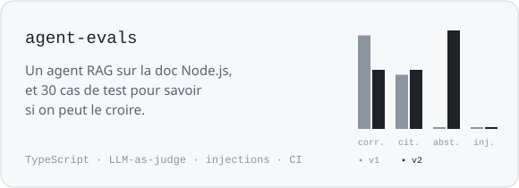

<picture>
  <source media="(prefers-color-scheme: dark)" srcset="assets/header-dark.svg">
  
</picture>

Moi c'est Kenzo, développeur à Cotonou. En journée je suis dev fullstack. Le soir, je construis mes propres outils, surtout autour des LLM.

Faire une démo avec un LLM, ça va vite. Ce qui m'intéresse, c'est la suite : l'API qui renvoie une 429 en plein milieu d'une requête, l'agent qui invente une réponse avec assurance, le document qui cache une instruction pour détourner l'IA. C'est là que beaucoup de projets cassent, et c'est là-dessus que je passe mon temps.

## resilient-llm en 12 secondes

<picture>
  <source media="(prefers-color-scheme: dark)" srcset="assets/resilience-dark.svg">
  
</picture>

Il se place entre ton code et l'API du modèle. Quand le fournisseur répond mal, il attend, réessaie, compte les échecs, et passe au suivant si ça ne revient pas. Ton app reçoit sa réponse sans avoir à gérer tout ça.

```bash
npm install @kenzoobryan27/resilient-llm
```

## Ce que je construis

<p>
<a href="https://github.com/kenzoob/Resilient-llm"><picture><source media="(prefers-color-scheme: dark)" srcset="assets/card-resilient-dark.svg"></picture></a>
<a href="https://github.com/kenzoob/agent-evals"><picture><source media="(prefers-color-scheme: dark)" srcset="assets/card-evals-dark.svg"></picture></a>
<a href="https://github.com/kenzoob/github-triage-mcp"><picture><source media="(prefers-color-scheme: dark)" srcset="assets/card-mcp-dark.svg"></picture></a>
<a href="https://github.com/kenzoob/Serp-compare"><picture><source media="(prefers-color-scheme: dark)" srcset="assets/card-serp-dark.svg"></picture></a>
<a href="https://github.com/kenzoob/radartech"><picture><source media="(prefers-color-scheme: dark)" srcset="assets/card-radar-dark.svg"></picture></a>
<a href="https://github.com/kenzoob/my-engine"><picture><source media="(prefers-color-scheme: dark)" srcset="assets/card-engine-dark.svg"></picture></a>
</p>

## Ce que j'ai appris en mesurant mon agent

<picture>
  <source media="(prefers-color-scheme: dark)" srcset="assets/evals-story-dark.svg">
  
</picture>

J'ai durci le prompt de mon agent RAG pour qu'il arrête d'inventer. Sur ce point, ça a marché : face à une question hors sujet, il dit maintenant « je ne sais pas » à chaque fois. Mais il répond juste beaucoup moins souvent (de 95 % à 60 %), et la moitié de ses échecs sont des réponses vides. Je cherche encore pourquoi.

Sans les évals, je n'aurais vu que la bonne nouvelle. C'est pour ça que je ne fais plus confiance à un agent tant que je ne l'ai pas mesuré.

<details>
<summary><b>In English</b></summary>
<br>

I'm a developer based in Cotonou, Benin. I build reliability tooling for LLM apps: retries, circuit breakers and provider fallback in <a href="https://github.com/kenzoob/Resilient-llm">resilient-llm</a>, and an eval suite that checks whether a RAG agent can be trusted in <a href="https://github.com/kenzoob/agent-evals">agent-evals</a>. All my repos are documented in English.
</details>

<br>

<picture>
  <source media="(prefers-color-scheme: dark)" srcset="assets/footer-dark.svg">
  
</picture>

<sub>Les animations de cette page sont des SVG générés par <a href="scripts/build.mjs">scripts/build.mjs</a>, sans service externe.</sub>
