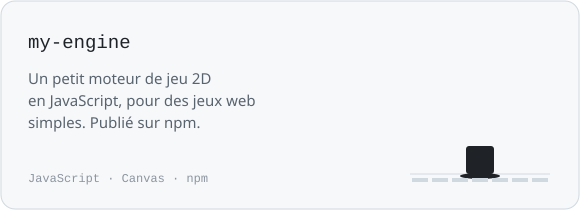
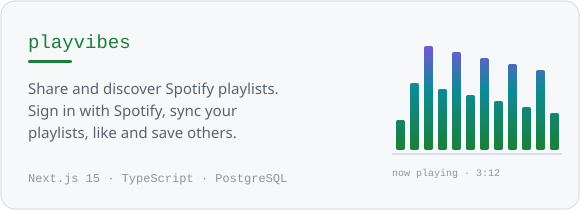

<picture>
  <source media="(prefers-color-scheme: dark)" srcset="assets/header-dark.svg">
  
</picture>

Hi, I'm Kenzo, a fullstack developer. Most of what I write is TypeScript and Node.js, with Python, Flutter or C when a project needs it.

Outside of work I build things mainly to understand them. I wrote a shell to see what actually happens between `fork` and `exec`, a small game engine to get a game loop right, and a few tools around the APIs I use every day.

<picture>
  <source media="(prefers-color-scheme: dark)" srcset="assets/night-dark.svg">
  
</picture>

<picture>
  <source media="(prefers-color-scheme: dark)" srcset="assets/board-dark.svg">
  
</picture>

## Projects

<a href="https://github.com/kenzoob/my-engine"><picture><source media="(prefers-color-scheme: dark)" srcset="assets/card-engine-dark.svg"></picture></a>
<a href="https://github.com/kenzoob/minishell"><picture><source media="(prefers-color-scheme: dark)" srcset="assets/card-shell-dark.svg"></picture></a>
<a href="https://github.com/kenzoob/playvibes"><picture><source media="(prefers-color-scheme: dark)" srcset="assets/card-vibes-dark.svg"></picture></a>
<a href="https://github.com/kenzoob/Serp-compare"><picture><source media="(prefers-color-scheme: dark)" srcset="assets/card-serp-dark.svg"></picture></a>
<a href="https://github.com/kenzoob/Resilient-llm"><picture><source media="(prefers-color-scheme: dark)" srcset="assets/card-resilient-dark.svg"></picture></a>
<a href="https://github.com/kenzoob/github-triage-mcp"><picture><source media="(prefers-color-scheme: dark)" srcset="assets/card-mcp-dark.svg"></picture></a>

 

<picture>
  <source media="(prefers-color-scheme: dark)" srcset="assets/graph-dark.svg">
  
</picture>

<picture>
  <source media="(prefers-color-scheme: dark)" srcset="assets/footer-dark.svg">
  
</picture>

Every animation on this page is a plain SVG generated by <a href="scripts/build.mjs">scripts/build.mjs</a>.
