<picture>
  <source media="(prefers-color-scheme: dark)" srcset="assets/header-dark.svg">
  
</picture>

Hi, I'm Kenzo. I work as a fullstack developer, and in the evenings I build my own tools, mostly around LLMs.

Getting a demo to work is usually the quick part. I spend more time on what happens after, when the API starts returning 429s in the middle of a request, or when the agent gives a confident answer that isn't anywhere in the docs. I like writing the code that handles that, and then checking that it really does.

<picture>
  <source media="(prefers-color-scheme: dark)" srcset="assets/night-dark.svg">
  
</picture>

<picture>
  <source media="(prefers-color-scheme: dark)" srcset="assets/board-dark.svg">
  
</picture>

## resilient-llm

<picture>
  <source media="(prefers-color-scheme: dark)" srcset="assets/resilience-dark.svg">
  
</picture>

It sits between your code and the model's API. When a provider fails, it waits, retries, counts the failures, and moves on to the next provider if things don't recover. Your app gets its response and doesn't have to know any of that happened.

```bash
npm install @kenzoobryan27/resilient-llm
```

## Projects

<p>
<a href="https://github.com/kenzoob/Resilient-llm"><picture><source media="(prefers-color-scheme: dark)" srcset="assets/card-resilient-dark.svg"></picture></a>
<a href="https://github.com/kenzoob/agent-evals"><picture><source media="(prefers-color-scheme: dark)" srcset="assets/card-evals-dark.svg"></picture></a>
<a href="https://github.com/kenzoob/github-triage-mcp"><picture><source media="(prefers-color-scheme: dark)" srcset="assets/card-mcp-dark.svg"></picture></a>
<a href="https://github.com/kenzoob/Serp-compare"><picture><source media="(prefers-color-scheme: dark)" srcset="assets/card-serp-dark.svg"></picture></a>
</p>

## Testing my own agent

<picture>
  <source media="(prefers-color-scheme: dark)" srcset="assets/evals-story-dark.svg">
  
</picture>

I made my RAG agent's prompt stricter so it would stop making things up. That part worked: on off-topic questions it now says "I don't know" every time. But it also got much worse at normal questions, going from 95% correct to 60%, and half of those failures are empty answers. I haven't found out why yet.

If I had only looked at the hallucination numbers, I would have shipped v2 thinking it was an improvement.

<br>

<picture>
  <source media="(prefers-color-scheme: dark)" srcset="assets/graph-dark.svg">
  
</picture>

<picture>
  <source media="(prefers-color-scheme: dark)" srcset="assets/footer-dark.svg">
  
</picture>

<sub>Every animation on this page is a plain SVG generated by <a href="scripts/build.mjs">scripts/build.mjs</a>.</sub>
